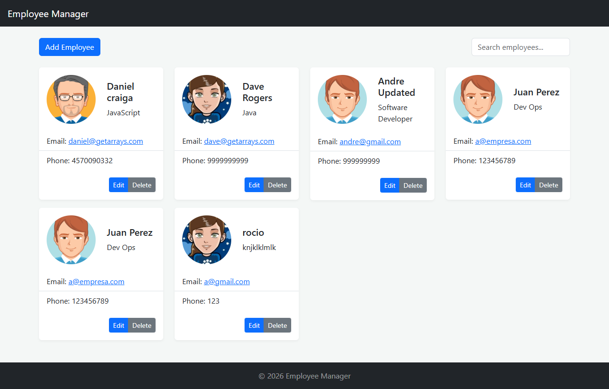
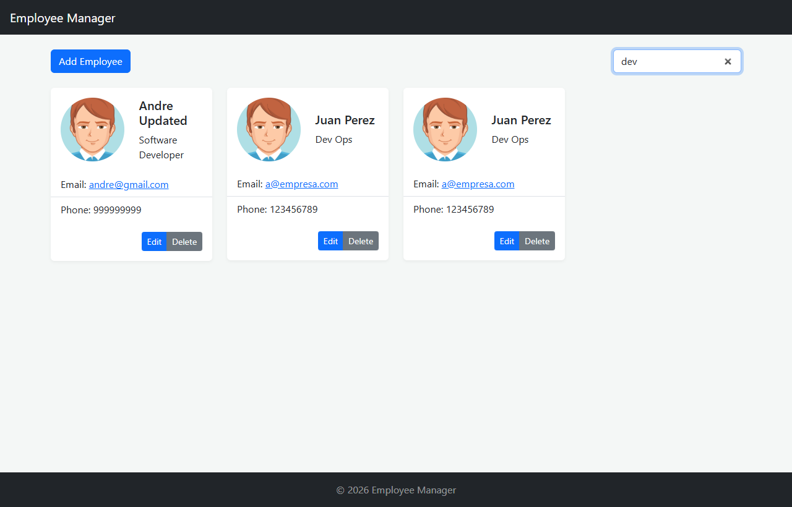
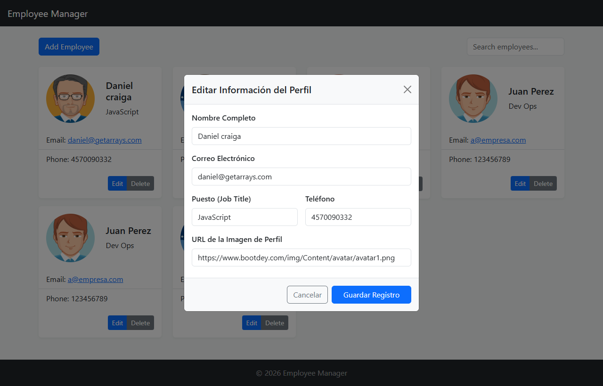
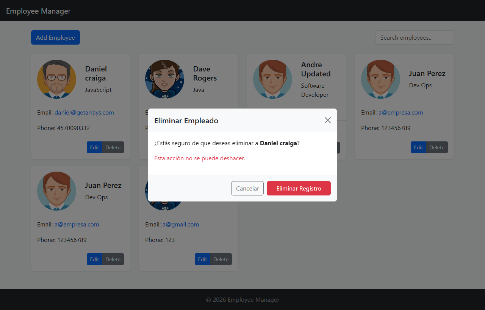

# Employee Manager

[](https://angular.dev/)
[](https://spring.io/projects/spring-boot)
[](https://www.oracle.com/java/)
[](https://www.typescriptlang.org/)
[](https://getbootstrap.com/)
[](https://www.mysql.com/)

Sistema de gestión de empleados full-stack: **Spring Boot** (API REST) + **Angular** (SPA). Implementa CRUD completo, búsqueda en tiempo real y comunicación REST con CORS configurado.

> **Créditos:** basado en el tutorial de [Get Arrays (YouTube)](https://www.youtube.com/watch?v=Gx4iBLKLVHk&t=5252s), refactorizado con Spring Boot 4 (Jakarta EE) y Angular moderno (Standalone Components, Signals, control flow `@for`/`@if`).

---

## Capturas

| Vista General | Búsqueda en Tiempo Real |
| :---: | :---: |
|  |  |

| Editar Empleado | Eliminar Empleado |
| :---: | :---: |
|  |  |

---

## Arquitectura

```
Navegador (Angular :4200)  ──HTTP/JSON──►  Spring Boot (:8080)  ──JPA/SQL──►  MySQL
```

```
Clientele_Manager/
├── employeemanager/                 # Backend (Spring Boot + Spring Data JPA)
│   └── src/main/java/tech/getArray/employeemanager/
│       ├── EmployeemanagerApplication.java  # Punto de entrada + CORS
│       ├── EmployeeResource.java            # Controller REST
│       ├── service/EmployeeService.java     # Lógica de negocio
│       ├── repo/EmployeeRepo.java           # Repositorio JPA
│       ├── model/Employee.java              # Entidad
│       └── exception/UserNotFoundException.java
│
└── employeemanagerapp/              # Frontend (Angular)
    └── src/app/
        ├── app.ts / app.html        # Shell: header + <router-outlet> + footer
        ├── app.routes.ts            # Rutas ('' → EmployeeList)
        ├── app.config.ts            # Providers (router, HttpClient con fetch, hidratación)
        ├── employee.ts              # Interface Employee
        ├── employee-service.ts      # Servicio HTTP
        ├── layout/                  # Header y Footer globales
        └── employees/               # Feature: lista, búsqueda, modales add/edit/delete
```

**Backend en capas:** `Controller → Service → Repository → MySQL`.
**Frontend:** `Componente → Servicio → HttpClient → API`, con estado en **Signals**.

### API REST

| Método | Endpoint | Descripción |
|---|---|---|
| GET | `/employee/all` | Lista todos |
| GET | `/employee/find/{id}` | Busca por id |
| POST | `/employee/add` | Crea (genera `employeeCode` UUID) |
| PUT | `/employee/update` | Actualiza |
| DELETE | `/employee/delete/{id}` | Elimina |

---

## Requisitos

- Java JDK 26 (el `pom.xml` usa `java.version=26`)
- Node.js 20+ y npm
- MySQL 8 **o** Docker

---

## Ejecución local

### 1. Backend

```bash
cd employeemanager
./mvnw spring-boot:run
```

Corre en `http://localhost:8080`. La conexión se configura con variables de entorno (con valores por defecto para local) en `src/main/resources/application.properties`:

| Variable | Defecto |
|---|---|
| `DB_HOST` | `localhost` |
| `DB_PORT` | `3306` |
| `DB_NAME` | `employeemanager` |
| `DB_USER` | `root` |
| `DB_PASSWORD` | definida en `application.properties` (cámbiala por la tuya) |

La base de datos se crea sola (`createDatabaseIfNotExist=true`) y las tablas con `ddl-auto=update`.

### 2. Frontend

```bash
cd employeemanagerapp
npm install
ng serve
```

Abre `http://localhost:4200`. La URL del backend está en `src/environments/environment.ts` (`apiUrl`).

> El backend debe estar encendido antes de abrir el frontend; si no, la lista muestra una alerta de error.

---

## Ejecución con Docker (backend + MySQL)

El frontend **no** está dockerizado; se ejecuta con `ng serve`.

1. Crea tu `.env` a partir de la plantilla:

   ```bash
   cd employeemanager
   cp .env.example .env
   ```

   Edita `DB_PASSWORD` con una contraseña propia. `.env` está ignorado por git.

2. Compila el JAR (el `dockerfile` copia `target/employeemanager-0.0.1-SNAPSHOT.jar`):

   ```bash
   ./mvnw package -DskipTests
   ```

3. Levanta los contenedores:

   ```bash
   docker compose up -d --build
   ```

| Servicio | Acceso |
|---|---|
| API Spring Boot | `http://localhost:8080` |
| MySQL | `localhost:3307` (puerto del host; interno 3306) |

Comandos útiles:

```bash
docker compose ps          # estado
docker compose logs -f     # logs
docker compose down        # detener (conserva datos)
docker compose down -v     # detener y borrar datos
```

La app espera al `healthcheck` de MySQL antes de arrancar (`depends_on: service_healthy`) y los datos persisten en el volumen `mysql_data`.

---

## Pruebas

```bash
cd employeemanagerapp && ng test --watch=false   # frontend (Vitest)
cd employeemanager && ./mvnw test                # backend
```

---

## Mejoras pendientes

- Autenticación y autorización (Spring Security + JWT).
- DTOs y validación (`@Valid`) en el backend.
- `@RestControllerAdvice` para devolver 404 en `UserNotFoundException` (hoy responde 500).
- Dividir `EmployeeList` en `EmployeeCard` y `EmployeeModal` y cerrar modales sin manipular el DOM.
- Migraciones con Flyway en lugar de `ddl-auto=update`.
- Dockerfile multi-etapa y dockerización del frontend.
- Quitar la contraseña por defecto de `application.properties`.
